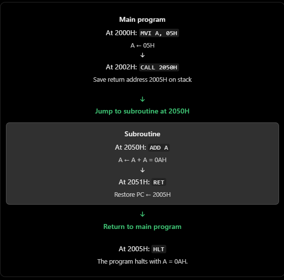

## `CALL` and `RET` in 8085 Microprocessor

A subroutine is a section of code that performs a particular task and can be called whenever that task is needed. It helps us avoid writing the same instructions repeatedly.

For example, suppose a program needs to add the contents of the accumulator to itself five times in different parts of the program. Instead of writing `ADD A` repeatedly, we can write the operation once in a subroutine and call it whenever required.

### 1. What does `CALL` do?

The `CALL` instruction transfers program execution to a subroutine.

Syntax:

```
CALL address
```

Example:

```
CALL 2050H
```

This tells the 8085 to execute the subroutine beginning at memory address `2050H`.

However, before jumping there, the processor must remember where it should return after the subroutine finishes. It does this by saving the return address on the stack.

The return address is the address of the instruction immediately following `CALL`.

### 2. What does `RET` do?

The `RET` (Return) instruction brings execution back to the instruction following the original `CALL`.

```
RET
```

It retrieves the saved return address from the stack and loads it into the Program Counter (PC).

The PC then points to the next instruction in the main program.

### 3. Understand the complete process

Consider this example:

```
2000H: MVI A, 05H
2002H: CALL 2050H
2005H: HLT

2050H: ADD A
2051H: RET
```

Assume the Stack Pointer is initialized to a valid RAM address.



Notice that the processor does not return to `2002H`, where `CALL` is located. It returns to `2005H`, the instruction immediately after the three-byte `CALL` instruction.

### 4. What happens to the stack?

The stack is a reserved area of memory used to store temporary information, including return addresses.

The Stack Pointer (SP) holds the address associated with the top of the stack. In the 8085, the stack normally grows toward lower memory addresses.

When executing `CALL`:

1. The processor calculates the return address.
2. It saves that 16-bit address on the stack.
3. The SP decreases by two.
4. The PC is loaded with the subroutine's starting address.

When executing `RET`:

1. The processor retrieves the saved 16-bit return address from the stack.
2. The SP increases by two.
3. The restored address is loaded into the PC.

This is why `CALL` and `RET` work together: `CALL` saves the return location, and `RET` retrieves it.

### 5. Do `CALL` and `RET` affect flags?

Neither `CALL` nor `RET` directly modifies the 8085's condition flags.

| Instruction      | Purpose                                           | Flags affected  |
| ---------------- | ------------------------------------------------- | --------------- |
| `CALL address` | Saves the return address and transfers control    | None            |
| `RET`          | Restores the return address and resumes execution | None            |
| `ADD A`        | Adds A to itself                                  | S, Z, AC, P, CY |

In the example, the flags may change because of `ADD A`, but not because of `CALL` or `RET`.

### 6. `CALL` vs `JMP`

| Feature                                       | `CALL`                      | `JMP`                              |
| --------------------------------------------- | ----------------------------- | ------------------------------------ |
| Transfers execution                           | Yes                           | Yes                                  |
| Saves return address on the stack             | Yes                           | No                                   |
| Automatically returns to the next instruction | With `RET`                  | No                                   |
| Typical purpose                               | Execute a reusable subroutine | Transfer control to another location |

For example, if you use `JMP 2050H`, the processor jumps to `2050H` without saving where it came from. A `RET` at the destination would only work correctly if a valid return address had already been placed on the stack.

### 7. Important exam points

- `CALL` is a 3-byte instruction in the 8085.
- `RET` is a 1-byte instruction.
- The Program Counter (PC) tracks the next instruction to execute.
- The Stack Pointer (SP) tracks the top of the stack.
- The return address is the address immediately following `CALL`.
- The 8085 saves a 16-bit return address because memory addresses are 16 bits wide.
- A subroutine can use registers, but it must preserve any values that the calling program still needs. `CALL` does not automatically save all registers.
- If a subroutine calls another subroutine, the stack keeps the return addresses in last-in, first-out (LIFO) order.

Memory aid: `CALL` = save the way back and go there. `RET` = retrieve the way back and return.
